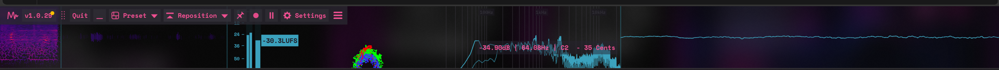

# MeterBar

**A professional audio meter bar for Windows** — spectrum, waveform, loudness, stereometer and oscilloscope in one slim strip that hugs the edge of your screen.

MeterBar sits at the edge of your monitor — bottom, top, or either side — and shows you what your audio is doing while you work, game, stream, or produce music. It listens to whatever Windows is already playing, so there is nothing to route, no virtual cables, and nothing to configure: launch it, play something, watch it move.

## What it does

Most meter plugins live inside a DAW and only see one track. MeterBar lives on your desktop and sees **everything your computer plays** — your DAW, Spotify, a game, a browser video, a Discord call — all in real time, all the time, without stealing screen space from the app you're actually using.

### Six metering modules, one strip

- **Spectrum** — a real-time frequency analyser (FFT sizes 1024–16384, adjustable smoothing and tilt) so you can see where the energy in your audio actually sits, from sub-bass to air.
- **Spectrogram** — the spectrum drawn over time: a scrolling heat map that makes sweeps, resonances, feedback and noise floors obvious at a glance.
- **Waveform** — the live shape of the sound, so transients, clipping and silence are visible the moment they happen.
- **Loudness** — proper loudness metering with LUFS momentary and short-term readings plus RMS ballistics, the same language streaming platforms and broadcast standards use — handy for checking whether a track, stream or video is at a sane level.
- **Stereometer** — five stereo-field displays that show how wide your audio is and whether it's mono-safe, so a mix that collapses on a phone speaker doesn't surprise you.
- **Oscilloscope** — the raw signal trace (pitch-locked or free-running) for detailed work: transients, phase, and waveform shape.

Every module can be resized by dragging its divider, rearranged to taste, and saved as a **preset layout** — one for producing, one for streaming, one for just vibing.

### It docks to your screen — and reserves its space

MeterBar can dock to **any edge** of your screen. Turn on **Reserve** and Windows treats the bar like part of the desktop frame: maximised windows stop at the bar instead of sliding underneath it, the way MiniMeters behaves. **Arrange** slides floating windows clear of the bar; **Restore** puts everything back where it was. The bar is always visible and never in the way.

### Looks the way you want

Five themes — **Midnight Kids, Midnight Pink, Deep Teal, Daylight, and Anime** — plus a family of spectrum colour maps (Plasma, Rainbow, Inferno, and more). The Anime theme adds a mascot who lives in her own cell at the end of the strip, bobs along to beat onsets, and cheers when it gets loud.

Settings always opens in a fixed deep pink-plum palette (`#2A1E2E`, accent `#E04C89`) in every theme — a settings sheet is no place for a flashbang.

### It updates itself

MeterBar checks for updates when it launches and from its menu. When a newer version is published here, it shows the version **and its full release notes** in the app, then can download the installer, verify it (size + SHA-256 against what GitHub published), install it, and relaunch itself at the new version. No hunting for downloads, no reinstalling by hand.

## Gallery

**On a real desktop** — docked at the bottom of the screen, all six modules live:

**Settings** — the fixed pink-plum palette:

**The mascot** (Anime theme):

## Install

Installers are published on the [Releases](https://github.com/Corporal8065/meterbar/releases) page — the first public release lands with **v0.19.2**. Download `MeterBar-Setup.exe`, run it, and MeterBar is ready; your presets and settings live outside the app folder, so reinstalling or updating never wipes them.

**SmartScreen note:** MeterBar is an unsigned independent app, so Windows may show *"Windows protected your PC"* the first time you run the installer. Click **More info → Run anyway**. Every release installer is built from this exact source tree by the GitHub Actions workflow in this repository.

## Build from source

You need **Visual Studio 2022** with the *"Desktop development with C++"* workload. No C++ knowledge required — the build is one double-click:

- **`build.bat`** — builds the app for testing.
- **`build-release.bat`** — builds the shareable installer (needs [Inno Setup 6](https://jrsoftware.org/isdl.php)).

The app is built with [JUCE](https://juce.com) and a hand-rolled DSP core; the version lives in exactly one place (the `project(VERSION)` line in the root `CMakeLists.txt`) and everything else — UI, installer, updater — reads from it.

## The family

MeterBar is the first of a small family of edge-of-screen bars. Its siblings live in **their own repositories** — one app, one repo, one updater each:

- **TickerBar** — a slim crypto ticker bar (BTC / ETH / HYPE: price, 24h change, sparkline, plus Fear & Greed and BTC dominance).
- **SessionBar** — market-session clocks and countdowns (New York / London / Tokyo) in the same strip format.
