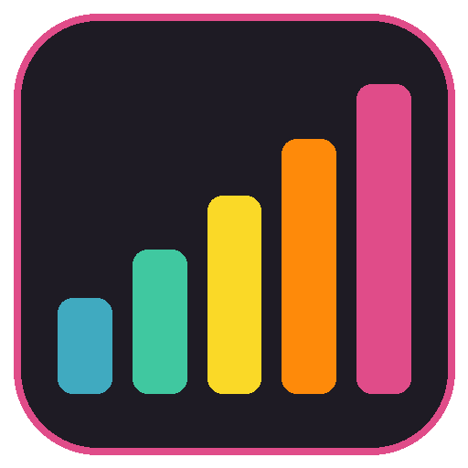
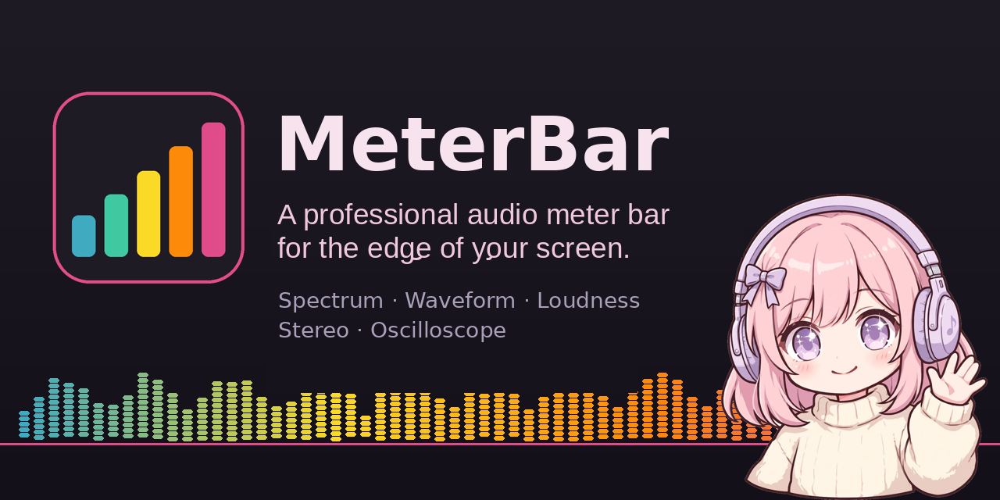
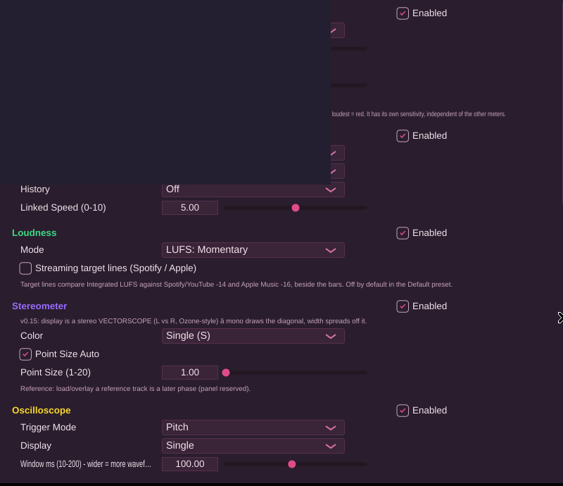

  

<h1 align="center">MeterBar</h1>

  A pretty little audio meter bar for Windows — spectrum, waveform, loudness, stereometer and oscilloscope in one slim strip that hugs the edge of your screen.

  
  <a href="https://github.com/Corporal8065/meterbar/releases/latest"><strong>Download latest release</strong></a>

<!-- The badge above lights up once this repo's first push and GitHub
     Actions run have happened; the workflow (build-windows.yml) is in
     the tree and builds every version tag. -->

MeterBar sits at the edge of your monitor — bottom, top, or either side — and shows you what your audio is doing while you work, game, or produce. It hears whatever Windows is playing (WASAPI loopback), so there is nothing to route and nothing to set up: launch it, play something, watch it move.

## Features

- **Six modules, one strip** — Spectrogram, Waveform, Loudness (LUFS momentary/short-term + RMS ballistics), Stereometer (5 modes), Oscilloscope (pitch/free), and Spectrum (FFT 1024–16384, smoothing, tilt). Resize modules by dragging their dividers; save your layout as presets.
- **Edge docking + Reserve** — dock the bar to any screen edge and turn on **Reserve**: maximised windows stop at the bar instead of sliding underneath it (the way MiniMeters behaves). **Arrange** slides floating windows clear of the bar; **Restore** puts everything back.
- **Five themes** — Midnight Kids, Midnight Pink, Deep Teal, Daylight, and Anime — with a family of spectrum colour maps (Plasma, Rainbow, Inferno, …). **Settings is always a deep pink-plum** (`#2A1E2E`, accent `#E04C89`) in every theme, because the settings sheet is no place for a flashbang.
- **A mascot** — in the Anime theme she gets her own cell at the end of the strip, bobs on beat onsets, and cheers when it gets loud. Cute click sounds included, Anime theme only.
- **Visualizer background** (v0.20.0, off by default) — black background, white particles converging to the centre, and rainbow brush-stroke bursts fired by the low/mid/high bands, over a blurred glow layer; palette controls (base hue, saturation, spread, cycle) in Settings → Appearance. Particle count is hard-capped for gaming PCs.
- **One exact frequency axis** — the spectrum and spectrogram share the DSP core's single frequency mapping, and the oscilloscope's **Multi** mode is a true 3-band split (LOW / MID / HIGH lanes) instead of a redrawn channel.
- **In-app updates** — MeterBar checks for updates on launch and from the menu, shows the new version **and its full release notes** in-app, and can download, verify (size + SHA-256), install, and relaunch itself. See *Updating* below for the one honest catch.

## Install

1. Download **`MeterBar-Setup.exe`** from the [Releases](https://github.com/Corporal8065/meterbar/releases) page.
2. Run it. The installer puts MeterBar in Program Files and adds a Start Menu entry; your presets and settings live outside the app folder, so reinstalling never wipes them.
3. **SmartScreen note:** MeterBar is unsigned (it's a small independent app, not a commercial release), so Windows may show *"Windows protected your PC"*. Click **More info → Run anyway**. The installer is built from this exact source tree by the GitHub Actions workflow in this repo.

## Updating

- MeterBar **checks on launch** (silently — it never pops a dialog at startup) and any time you pick **Check For Updates** from the menu.
- If a newer release exists, the toolbar grows a pink **Update!** button. Click it (or check from the menu) to see the version and its release notes, then **Download & install**: MeterBar downloads the installer, verifies its size and SHA-256 against what GitHub published, closes, installs, and relaunches at the new version.
- **While this repo is private:** GitHub doesn't show a private repo's releases to an app that isn't signed in — and MeterBar deliberately carries no sign-in token, because a token baked into a shipped app isn't secret. So for now, the check will tell you automatic updates aren't available and offer an **Open releases page** button instead; grab updates from the [Releases](https://github.com/Corporal8065/meterbar/releases) page in your browser, where you're signed in. If the repo ever goes public, the same build does the full in-app flow with no changes.

## Build from source

You need **Visual Studio 2022** with the *"Desktop development with C++"* workload. No C++ knowledge required — the build is one double-click:

- **`build.bat`** — builds the app for testing (`build-app\app\MeterBar_artefacts\Release\MeterBar.exe`).
- **`build-release.bat`** — builds the shareable installer (`dist\MeterBar-Setup.exe`, needs [Inno Setup 6](https://jrsoftware.org/isdl.php)).

The app version lives in exactly **one** place — the `project(VERSION)` line in the root `CMakeLists.txt` — and everything else (UI, installer, updater) reads from it. The pure DSP core under `dsp/` has its own test suite (`tests/test_dsp.cpp`), which also runs in CI.

## Gallery

**The mascot** (Anime theme):

**Settings** — the fixed pink-plum palette. This shot is the Linux verification build running under a virtual screen (hence the clipped window); the Windows build renders the same palette with a proper dark title bar:

### Settings & themes — screenshots wanted

Real Windows screenshots of these are wanted for this section. If you're running MeterBar on Windows, these exact shots would complete the gallery:

- The bar itself docked on a **real Windows desktop** (bottom edge), all modules live
- Settings window on Windows in the **fixed pink palette** (replacing the Linux-build shot above)
- Settings window in the **Midnight Kids** theme
- Settings window in the **Anime** theme
- Settings window in the **Daylight** theme
- The bar itself in each theme: **Midnight Kids**, **Midnight Pink**, **Deep Teal**, **Daylight**, **Anime** (mascot visible)
- The **Visualizer background** running live (bands bursting) — a still can only suggest it; a short clip would be better

## The family

MeterBar is the first of a small family of edge-of-screen bars. Its siblings live in **their own repositories** (one app, one repo, one updater each):

- **TickerBar** — a slim crypto ticker bar (BTC / ETH / HYPE, price, 24h change, sparkline).
- **SessionBar** — market-session countdowns (New York / London / Tokyo) in the same strip format.

---

*Built with [JUCE](https://juce.com) and a hand-rolled DSP core. Made with JUCE — free-license attribution.*
